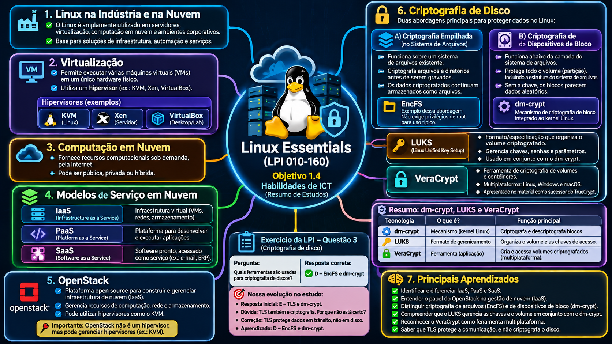

Linux Essentials 010-160 — Objetivo 1.4
Anotações de estudo — Segurança, privacidade e criptografia
Material: Linux Essentials, versão 1.6 — LPI
Status: Em andamento — leitura teórica e cinco exercícios guiados concluídos; revisão e consolidação dos conceitos em andamento.
Este documento registra os conceitos estudados e a resolução comentada dos exercícios guiados. Não documenta laboratórios executados nem atividades futuras como concluídas.

## 1. Linux na indústria e na nuvem
- Virtualização: permite executar máquinas virtuais em um computador físico, utilizando um hipervisor, como KVM, Xen ou VirtualBox.
- Computação em nuvem: fornece recursos computacionais sob demanda.
- IaaS: infraestrutura virtual, como servidores, redes e armazenamento.
- PaaS: plataforma para desenvolver e executar aplicações.
- SaaS: software disponibilizado como serviço.
- OpenStack: conjunto de componentes open source para gerenciar infraestrutura de nuvem, incluindo recursos de computação, rede e armazenamento.
## 2. Privacidade na Internet
- Cookies primários (first-party): podem manter sessões e preferências de um site.
- Cookies de terceiros (third-party): podem ser utilizados para rastreamento entre sites.
- Do Not Track (DNT): sinaliza uma preferência de não rastreamento, mas não obriga o site a respeitá-la.
- Navegação privada/anônima: reduz registros locais da sessão; não torna o usuário anônimo perante sites, redes ou provedores.
- HTTPS/TLS: protege dados transmitidos entre cliente e servidor, mas não elimina todos os riscos de privacidade.
- Computadores públicos: podem conter programas como keyloggers, capazes de capturar informações digitadas antes de serem protegidas pela transmissão criptografada.
## 3. Escolha a senha certa
- Usar senhas fortes, longas e exclusivas para cada serviço.
- Evitar reutilizar senhas: um vazamento pode permitir tentativas de acesso a outras contas (credential stuffing).
- Um gerenciador de senhas mantém credenciais em um cofre criptografado.
- KeePass: gerencia um banco de dados criptografado que pode ser armazenado localmente.
- Bitwarden: oferece cofre criptografado e sincronização entre dispositivos.
- A senha mestra deve ser forte, exclusiva e protegida.
- Backup e disponibilidade: conhecer a senha mestra não recupera um banco de dados local perdido se não existir outra cópia válida.
## 4. Criptografia e TLS
- Criptografia: transforma informações legíveis em dados protegidos, que dependem da chave apropriada para serem recuperados.
- TLS (Transport Layer Security): protocolo utilizado para proteger comunicações na rede; é o sucessor do SSL.
- HTTPS: utiliza TLS para proteger a comunicação HTTP e permite validar a identidade do servidor por meio de certificados digitais, conforme a confiança estabelecida.
## 5. Criptografia de arquivos e emails com GnuPG
GnuPG (GNU Privacy Guard) é uma implementação open source do padrão OpenPGP. Pode ser utilizado para criptografar, descriptografar e assinar mensagens e arquivos.
Chaves pública e privada
- Chave pública: pode ser compartilhada.
- Chave privada: deve permanecer secreta e protegida.
- Para enviar um arquivo confidencial a alguém, utiliza-se a chave pública do destinatário para criptografá-lo; a chave privada correspondente permite a descriptografia.
- Para assinar digitalmente, o autor usa sua chave privada; a assinatura é verificada com a chave pública do autor.
Integridade e assinatura digital
- Um hash criptográfico representa o conteúdo de um arquivo e ajuda a detectar modificações.
- Uma alteração de apenas uma letra pode invalidar a assinatura digital.
- Tamanho do arquivo não comprova integridade: dois arquivos podem ter o mesmo tamanho e conteúdos diferentes.
- Uma assinatura válida permite verificar a integridade e a relação com a chave que assinou; para associá-la a uma pessoa, é preciso confiar na identidade vinculada à chave pública.
Conceitos relacionados
- Confidencialidade: impedir leitura não autorizada.
- Integridade: detectar alterações indevidas.
- Autenticidade: verificar a origem declarada de uma informação.
## 6. Criptografia de disco
O material apresenta duas abordagens principais.
Criptografia empilhada no sistema de arquivos
- Funciona sobre um sistema de arquivos existente.
- Arquivos e diretórios são criptografados antes de serem gravados e descriptografados quando acessados pela camada apropriada.
- Os dados criptografados continuam armazenados como arquivos no sistema de arquivos hospedeiro.
- EncFS: ferramenta citada pelo material como exemplo desse método, sem exigir privilégios de root para seu uso típico.
Criptografia de dispositivos de bloco
- Funciona abaixo da camada do sistema de arquivos.
- Protege os dados gravados no dispositivo de bloco, incluindo estruturas do sistema de arquivos contidas no volume criptografado.
- Sem a chave adequada, os blocos parecem dados aleatórios e não revelam diretamente a estrutura do sistema de arquivos.
- dm-crypt: mecanismo de criptografia de bloco integrado ao kernel Linux.
- LUKS (Linux Unified Key Setup): formato/especificação usado com ferramentas de criptografia de bloco, normalmente em conjunto com dm-crypt.
VeraCrypt
- Ferramenta de criptografia de volumes e contêineres.
- Permite utilizar dados criptografados em diferentes plataformas, como Linux, Windows e macOS.
- É apresentado no material como sucessor do TrueCrypt.
## 7. Situação do estudo
- [x] Leitura e discussão: senhas e gerenciadores de senhas.
- [x] Leitura e discussão: TLS.
- [x] Leitura e discussão: GnuPG, chaves e assinaturas digitais.
- [x] Leitura: criptografia de disco, EncFS, dm-crypt/LUKS e VeraCrypt.
- [x] Exercícios guiados do Objetivo 1.4 — cinco questões respondidas e corrigidas; conceitos em revisão.
- [ ] Revisão final das anotações.
Referência: Linux Essentials (Versão 1.6), LPI Learning Materials, Objetivo 1.4, especialmente páginas 58–64.
Princípio de estudo: Estudar. Compreender. Praticar. Documentar. Compartilhar.

## 8. Exercícios guiados — resolução comentada e aprendizados

**Material:** Linux Essentials 010-160 — LPI, versão 1.6  
**Situação:** cinco exercícios respondidos e corrigidos. Revisão dos conceitos em andamento.

### Exercício 1 — Navegação privada e privacidade

**Resposta:** alternativa B — reduzir os vestígios locais da navegação no computador utilizado.

**Investigação realizada:** consulta às informações exibidas pelo Google Chrome em uma janela anônima e discussão sobre modo visitante, cookies e DNT.

**Aprendizados:**
- O modo anônimo reduz o armazenamento local do histórico, cookies e dados de formulários da sessão.
- Downloads e favoritos criados podem permanecer no computador.
- Sites, administradores de rede e provedores ainda podem observar informações sobre a atividade.
- O modo visitante separa a sessão de navegação do perfil habitual do Chrome.
- DNT (*Do Not Track*) expressa uma preferência de não rastreamento, sem obrigar os sites a respeitá-la.
- HTTPS/TLS protege a comunicação, mas não torna o usuário anônimo.

**Conclusão:** navegação privada não significa anonimato na Internet.

### Exercício 2 — OpenStack e IaaS

**Resposta:** alternativa A — projeto que permite criar uma infraestrutura de nuvem privada no modelo IaaS.

**Dúvida identificada:** diferença entre OpenStack, hipervisor e modelo de serviço.

**Aprendizados:**
- IaaS disponibiliza infraestrutura, como máquinas virtuais, redes e armazenamento.
- KVM é uma tecnologia de virtualização utilizada para executar máquinas virtuais.
- OpenStack é uma plataforma de gerenciamento de infraestrutura de nuvem e pode utilizar KVM.
- OpenStack não é, por si só, um hipervisor.

**Evolução:** após consultar a documentação do GitHub, foi possível reconhecer o modelo IaaS e explicar sua relação com VMs, redes e armazenamento.

### Exercício 3 — Ferramentas de criptografia de disco

**Resposta inicial:** alternativa E — TLS e dm-crypt.

**Resposta correta:** alternativa D — EncFS e dm-crypt.

**Origem do erro:** associação da palavra "criptografia" ao TLS, sem distinguir a proteção dos dados em trânsito da proteção dos dados armazenados.

**Aprendizados:**
- TLS protege dados em trânsito, como a comunicação HTTPS.
- EncFS é um exemplo de criptografia empilhada sobre um sistema de arquivos existente.
- dm-crypt é um mecanismo de criptografia de dispositivos de bloco integrado ao kernel Linux.
- LUKS é um formato para volumes criptografados, normalmente utilizado com dm-crypt; organiza informações e o gerenciamento das chaves.
- VeraCrypt é uma ferramenta para criar e acessar volumes e contêineres criptografados, com suporte a diferentes sistemas operacionais.

**Diferença fundamental:**
- dm-crypt: mecanismo que criptografa e descriptografa blocos.
- LUKS: formato que organiza o volume criptografado e suas chaves.
- VeraCrypt: software para trabalhar com volumes criptografados.
- TLS: protocolo para proteger comunicações.

**Revisão prática por questões:** foram respondidas corretamente perguntas sobre o papel do LUKS, o desbloqueio de volumes, o TLS e a diferença entre EncFS e dm-crypt.

**Ponto para continuar revisando:** explicar sem consulta a diferença entre dm-crypt e LUKS.

### Exercício 4 — Afirmações sobre dm-crypt

**Respostas corrigidas:**

1. Os arquivos são criptografados antes de serem escritos no disco — **Verdadeiro**.
2. O sistema de arquivos inteiro se torna uma massa criptografada — **Verdadeiro**.
3. Apenas arquivos e diretórios são criptografados, não os links simbólicos — **Falso**.
4. Não requer acesso de root — **Falso**, considerando a configuração e administração típicas de volumes dm-crypt.
5. É uma criptografia de dispositivo de bloco — **Verdadeiro**.

**Dúvida 1 — Como criptografar antes de gravar no SSD?**

A resposta inicial foi "falso", pois surgiu a dúvida de como criptografar algo que ainda não havia sido gravado.

**Correção:** os dados podem existir na memória RAM antes da gravação física. O dm-crypt criptografa os blocos durante a operação de escrita no dispositivo.

**Dúvida 2 — O que significa atuar abaixo do sistema de arquivos?**

Foi introduzido o ext4 como exemplo complementar de sistema de arquivos Linux.

**Sequência conceitual simplificada:**

RAM → sistema de arquivos (ext4) → dm-crypt → SSD

- ext4 organiza arquivos, diretórios e blocos.
- dm-crypt criptografa e descriptografa os blocos.
- SSD armazena fisicamente os dados.

Essa sequência representa a gravação em um volume configurado com dm-crypt; não significa que toda instalação Linux utilize criptografia.

**Dúvida 3 — Links simbólicos são protegidos?**

Sim. As informações dos links simbólicos armazenadas dentro do volume criptografado também são protegidas, pois o dm-crypt atua sobre os blocos do volume.

**Evolução:** após a explicação e novas perguntas, foi possível distinguir organização, criptografia e armazenamento.

### Exercício 5 — Beamer

**Resposta correta:** ferramenta de apresentações em LaTeX.

**Como a resposta foi identificada:** inicialmente por eliminação das alternativas, sem segurança sobre o conceito.

**Dúvida identificada:** associação do nome Beamer a uma lembrança de criação de banners no terminal.

**Correção:**
- Beamer é uma classe de documentos LaTeX utilizada para produzir apresentações de slides, geralmente em PDF.
- O aluno lembrou de um estudo anterior sobre criação de banners no terminal com `figlet`, realizado no início da jornada Linux.
- Esse estudo não pertence ao conteúdo abordado neste capítulo, Objetivo 1.4.
- A associação inicial entre Beamer e `figlet` foi esclarecida durante a revisão.

**Aprendizado:** acertar uma questão por eliminação é válido, mas não comprova domínio do conceito.

### Conclusão da revisão

Os cinco exercícios guiados foram respondidos e corrigidos. As dúvidas ajudaram a identificar pontos que exigiam explicações adicionais.

**Conceitos que precisam de nova revisão sem consulta:**
- DNT e limitações da navegação privada.
- Diferença entre OpenStack e hipervisor.
- TLS versus criptografia de dados armazenados.
- EncFS versus dm-crypt.
- Funções de dm-crypt, LUKS e VeraCrypt.
- Camadas de sistema de arquivos e dispositivos de bloco.
- Beamer e sua relação com LaTeX.

**Observação:** esta seção documenta leitura, investigação no navegador, discussão e resolução de exercícios. Não representa execução de laboratórios de criptografia.

**Princípio:** Estudar. Compreender. Praticar. Documentar. Compartilhar.

## 9. Mapa mental — Objetivo 1.4

### Visualização de Markdown no VS Code

Durante a documentação do Objetivo 1.4, foi utilizada a pré-visualização do Markdown no VS Code conectado ao Ubuntu via Remote SSH.

**Atalhos utilizados:**

- `Ctrl + Shift + V` — abre a pré-visualização do arquivo Markdown.
- `Ctrl + K`, depois `V` — abre a pré-visualização ao lado do editor.
- `Ctrl + S` — salva as alterações do arquivo.

**Aprendizado:**
O arquivo `.md` contém texto e referências às imagens. O VS Code interpreta o Markdown e apresenta títulos, listas, formatação e imagens na pré-visualização.

A imagem foi armazenada na pasta `imagens/` do repositório e referenciada no documento por um caminho relativo.

**Validação:** a imagem foi exibida corretamente na pré-visualização do VS Code.
